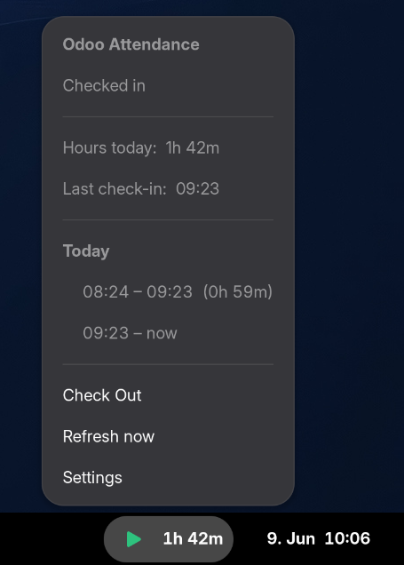
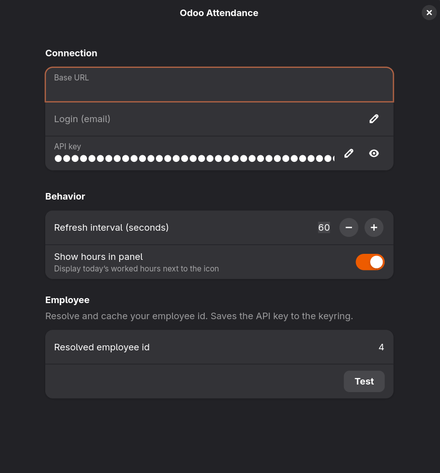

# Odoo Attendance — GNOME Shell extension

A GNOME Shell panel indicator that shows your Odoo **`hr.attendance`** status and lets you
**check in / out in one click**, with a live dashboard of today's hours, last check-in and
today's records. It talks to Odoo 19's **JSON-2 API** and keeps your API key in the system
keyring.


## Screenshots

| Panel menu | Preferences |
| --- | --- |
|  |  |

The panel icon turns green while you're checked in and, optionally, shows today's worked hours
next to it.

## Features

- One-click **check in / check out** from the panel.
- Live status: **checked in / out**, **hours today**, **last check-in**, and a list of
  **today's records**.
- Optional **worked-hours label** next to the panel icon.
- Configurable **refresh interval**.
- API key stored in the **keyring** (libsecret), never in dconf or plain text.
- Reads are **scoped to your own records** (`employee_id.user_id = <your uid>`).

## Requirements

- **GNOME Shell 45 – 50** (uses the modern ESM extension API and libadwaita ≥ 1.4).
  Developed and tested on **GNOME Shell 50**.
- **libsecret** typelib (`gir1.2-secret-1` / `libsecret`) — ships with GNOME by default.
- An **Odoo 19** instance reachable over HTTPS, with the **JSON-2 API** enabled.
- A personal **Odoo API key** (Odoo → *Preferences → Account Security → New API Key*) for an
  account that is linked to an `hr.employee` record.

## Install

### From source

```sh
git clone https://github.com/esyon/odoo-attendance-gnome.git
cd odoo-attendance-gnome

# Compile the GSettings schema (required for a symlinked install)
glib-compile-schemas schemas/

# Symlink into the local extensions directory
ln -sfn "$PWD" ~/.local/share/gnome-shell/extensions/odoo-attendance@esyon.de
```

Then load the extension:

- **Wayland:** log out and back in (the shell can't hot-reload extensions). To test without
  logging out, run a nested session:
  ```sh
  dbus-run-session -- gnome-shell --nested --wayland
  ```
- **X11:** press `Alt`+`F2`, type `r`, press `Enter`.

Finally enable it:

```sh
gnome-extensions enable odoo-attendance@esyon.de
```

### From a release archive

Download the `.shell-extension.zip` from the [Releases](https://github.com/esyon/odoo-attendance-gnome/releases) page and install it:

```sh
gnome-extensions install --force odoo-attendance@esyon.de.shell-extension.zip
```

Then log out and back in, and enable the extension as above.

## Configure

Open the preferences:

```sh
gnome-extensions prefs odoo-attendance@esyon.de
```

1. Enter your **Base URL** (e.g. `https://odoo.example.com`) and **Login** (your email).
2. Paste your **Odoo API key**.
3. Click **Test**. This authenticates, resolves and caches your user id + employee id, and
   saves the key to the keyring. The panel then shows your status and today's hours.

## Settings

| Key | Type | Description |
| --- | --- | --- |
| `base-url` | string | Odoo base URL, without trailing slash. Empty until configured. |
| `login-email` | string | Login used to resolve your user and employee id. |
| `user-id` | int | Cached `res.users` id (resolved by **Test**). |
| `employee-id` | int | Cached `hr.employee` id (resolved by **Test**). |
| `refresh-interval` | int | Panel refresh interval in seconds (15–3600). |
| `show-hours-label` | bool | Show today's worked hours next to the panel icon. |

## How it works

- **Auth:** `Authorization: bearer <api-key>` against `POST <base>/json/2/<model>/<method>`.
- State is derived purely from **`hr.attendance`** (an open record = checked in), because
  `hr.employee.attendance_state` / `total_overtime` are *Attendance Officer*-gated and a normal
  employee's `hr.employee` reads fall back to the field-limited `hr.employee.public`.
- Reads are scoped to your own records via `employee_id.user_id = <uid>`.
- Check in = `hr.attendance/create {vals_list:[{employee_id, check_in}]}`;
  check out = `hr.attendance/write {ids:[id], vals:{check_out}}`. Times are naive **UTC**.

## Security

The API key is stored in the GNOME keyring via **libsecret**, keyed per base URL, so it is
encrypted at rest with your login keyring and multiple Odoo instances don't collide. It is
never written to dconf and never logged.

## Development

`selftest.js` is a read-only diagnostic for the JSON-2 client (no mutations):

```sh
gjs -m selftest.js <api-key> <login-email> [base-url]
```

Build a release archive with the GNOME tooling:

```sh
gnome-extensions pack --force --extra-source=lib
# → odoo-attendance@esyon.de.shell-extension.zip
```

## Compatibility

| GNOME Shell | Status |
| --- | --- |
| 50 | ✅ Tested |
| 45 – 49 | Expected to work (same ESM API; not actively tested) |
| ≤ 44 | ❌ Unsupported (pre-ESM extension API) |

## Contributing

Issues and pull requests are welcome. Please keep the GTK/Adwaita code in `prefs.js` and the
shell-side code in `extension.js` separate, and make sure the extension cleans up fully in
`disable()`.

## License

[GPL-2.0-or-later](LICENSE) © esyon
